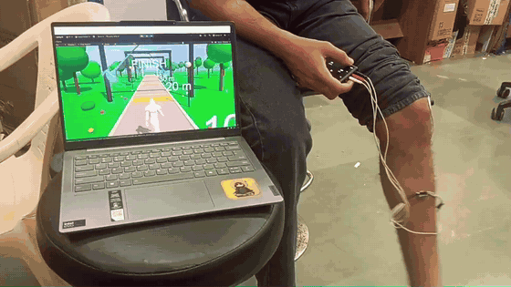
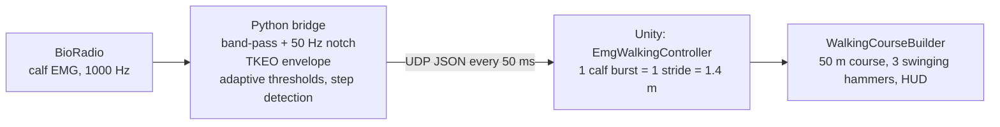
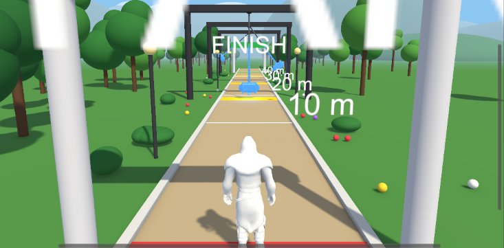
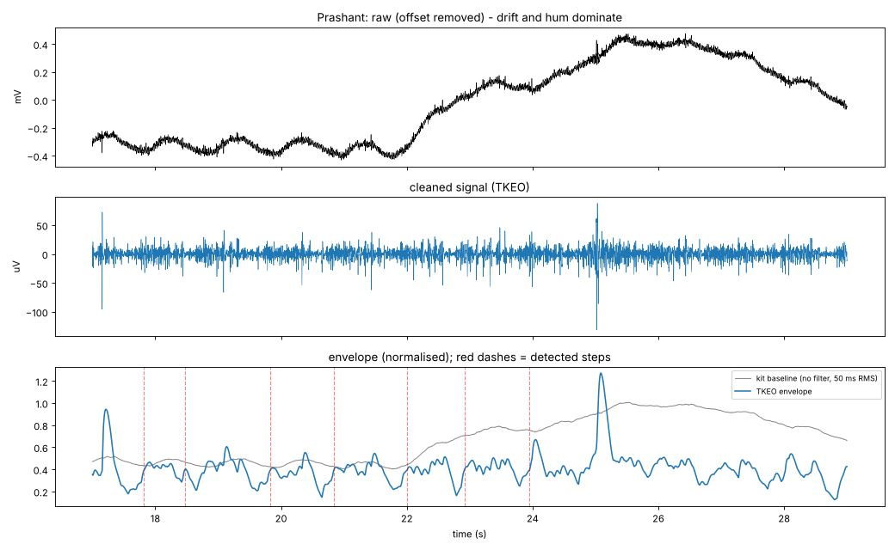
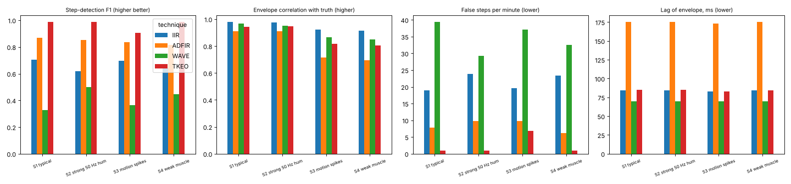

# Real-Time EMG Walking Control in Unity

   

Surface EMG from the calf muscle is filtered in real time and streamed into a Unity game: **every calf burst moves the character one stride** along a 50 m course, past three swinging hammers.

**[Try the interactive prototype in your browser →](https://YOUR-USERNAME.github.io/emg-vr-walking/)** Watch a real recording drive the walker, switch between the four filters, or hold a button to flex and dodge the hammers yourself. It runs the same filters and step detector as the Python bridge.



## Highlights

- **Four real-time filtering techniques compared** on the team's own walking recordings and on a synthetic benchmark with known step times: a classical IIR chain, an FIR filter with an adaptive LMS mains canceller, wavelet (db4) denoising, and the Teager–Kaiser energy operator (TKEO).
- **TKEO runs the game:** step-detection F1 0.97 with 2.4 false steps per minute and 84 ms lag on the benchmark.
- **Python bridge:** reads the BioRadio, filters the signal, detects steps and sends a UDP message to Unity every 50 ms. A replay tool and a keyboard mode let anyone try the game without the hardware.
- **Unity game:** builds its 50 m course at runtime (scenery, START/FINISH gates, three swinging hammers, follow camera, HUD). A hammer hit flashes the screen red and sends the player back to the start.

## How it works





## Results

All four techniques ran through the same real-time code on the same synthetic benchmark (4 scenarios × 5 seeds, known step times):

| Technique | Member | Step F1 | False steps / min | Lag (ms) | Envelope correlation | Weighted score (lower is better) |
|---|---|---|---|---|---|---|
| **TKEO** (used in the game) | Prashant | **0.97** | **2.4** | 84 | 0.88 | **1.62** |
| FIR + adaptive LMS + moving RMS | Mehul | 0.84 | 8.4 | 174 | 0.81 | 2.75 |
| Classical IIR chain | Akshit | 0.67 | 21.4 | 84 | **0.95** | 2.25 |
| Wavelet (db4) denoising | Naveen | 0.41 | 34.6 | **70** | 0.91 | 2.75 |

The ranking weights detection 50 %, responsiveness 25 % and signal fidelity 25 %; TKEO also wins with equal weights. On the real recordings, which have no ground-truth step count, all four recover a plausible 52–65 strides per minute, so TKEO's lead comes mainly from the synthetic benchmark. The full method and results are in the [project report](docs/Project9_Report.pdf).

 

## Run it

### 1. Open the game

1. Install **Unity 6** (made with 6000.6) and add the `unity` folder in Unity Hub (*Add → Add project from disk*).
2. On the first open the scene `Assets/Scenes/EMGWalking.unity` is built automatically (the menu **Project 9 → Rebuild Game Scene** rebuilds it). Open it and press **Play**.
3. Without the downloaded 3D models (see below) the player is a capsule and the hammers are the built-in ones; the game plays the same.

### 2. Control the character

| Way | Needs | How |
|---|---|---|
| Keyboard test | Nothing | Press Play, click the Game view, press **SPACE**: one press = one calf burst = one stride |
| Replay a real recording | Python 3 | `pip install -r requirements.txt`, then while Play is running: `python bridge/replay_csv_to_unity.py bridge/sample_recordings/Prashant_clean_walking.csv --mode I` |
| Live with the BioRadio | BioRadio on Windows, `BioRadioSDK.dll` next to the bridge script, `pip install pythonnet` | Close BioCapture, run `python bridge/bioradio_unity_bridge_v2.py`, then Scan → Connect → mode I → walk 10–20 s → Lock cal. |

### 3. Reproduce the analysis

```bash
pip install -r requirements.txt
cd analysis
python analysis_akshit.py        # also analysis_mehul.py, analysis_naveen.py, analysis_prashant.py
python comparative_analysis.py   # benchmark, comparison and ranking
python make_report_pdf.py        # writes docs/Project9_Report.pdf
```

## 3D models (not included)

The character and the hammer model are third-party downloads and are not redistributed here. For the original look, download the Mixamo character **Knight D Pelegrini** with the **Breathing Idle** and **Walking** animations (FBX for Unity, With Skin), put them in `unity/Assets/Models` and run **Project 9 → Rebuild Game Scene**. Details are in [`unity/Assets/Models/README.md`](unity/Assets/Models/README.md); `.gitignore` keeps model files in that folder out of the repository.

## Repository structure

```
unity/      Unity 6 (URP) project: game scripts, scene builder, project settings
bridge/     BioRadio-to-Unity bridge, replay tool, real-time filters, sample recording
analysis/   Offline analysis: per-member results, comparison and ranking, report generator
data/       Labelled calf-EMG recordings (one per member, 1000 Hz) and their description
docs/       Website (GitHub Pages: index.html + data/), project report (PDF), README images
```

## Team

Project 9 (SSRP):

- **Akshit**: classical IIR chain; noise analysis and clean-segment selection
- **Mehul**: FIR + adaptive LMS + moving RMS; real-time BioRadio bridge
- **Naveen**: wavelet denoising; synthetic benchmark and ranking
- **Prashant**: Teager–Kaiser energy operator; Unity game
